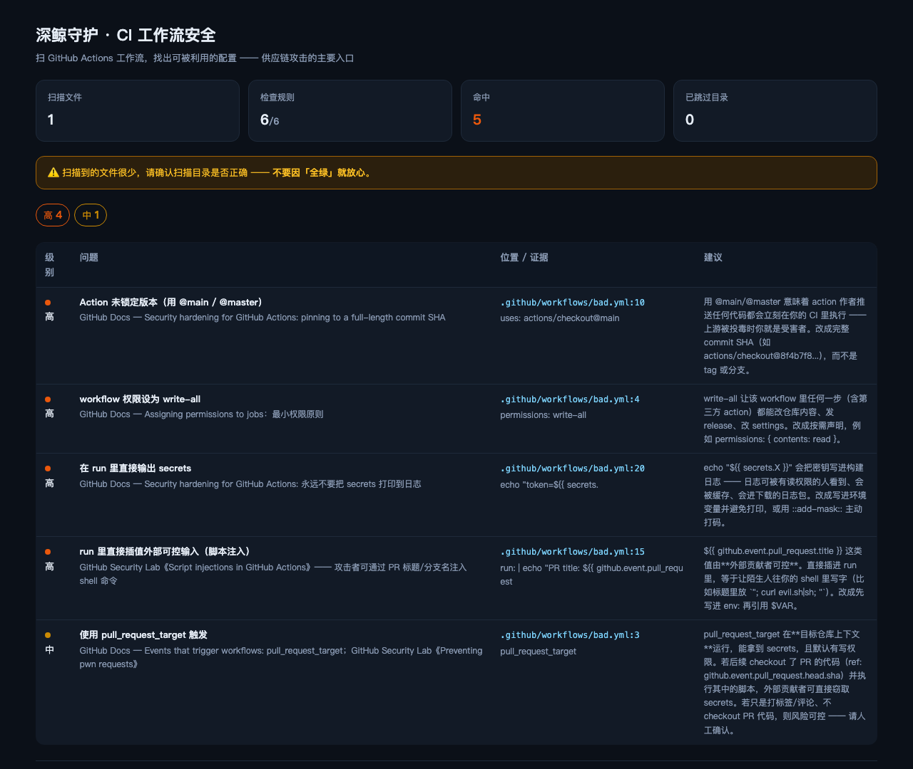

# @deepwhale-cn/dsh-ci-guard

**CI 工作流安全** —— 扫 GitHub Actions，找出可被外部利用的配置。

## 不装它会怎样

你的 workflow 里写着 `uses: some-action@main`。

某天那个 action 的作者账号被盗，攻击者推了一行代码 ——
**下一次 CI 运行就是在他的控制下执行的**，而你有 `secrets`。

锁成完整 commit SHA 就能防住这一类。这个检查跑一次几秒钟。

## 它查什么

| 级别 | 内容 |
|---|---|
| 🔴 高 | Action 未锁版本 · `permissions: write-all` · echo secrets · 脚本注入 |
| 🟡 中 | `pull_request_target`（需人工判断）|
| 🟢 低 | 未声明 `permissions` |

## 安装

```bash
dsh plugin --profile web add @deepwhale-cn/dsh-ci-guard
# 或纯 CLI
npx @deepwhale-cn/dsh-ci-guard
```

## 用法

```bash
dsh-ci-guard                 # 扫当前目录
dsh-ci-guard --demo          # 看检出效果
dsh-ci-guard --list-rules    # 列出规则和依据
dsh-ci-guard --html r.html   # HTML 报告
```



## 判据来源

每条规则都指向具体文档：
GitHub Docs《Security hardening for GitHub Actions》· GitHub Security Lab
《Preventing pwn requests》《Script injections in GitHub Actions》。

## 边界

- **正则匹配 YAML，不是真解析** —— 写法奇特（锚点、多文档）可能漏。
- **只覆盖 GitHub Actions**；GitLab CI / Jenkins 不在范围内。
- `pull_request_target` 单独出现不一定危险，**需要人工判断**。

本插件是一个工具。使用者必须遵守所在地区法律法规，**对使用本项目造成的任何后果自行承担责任。**

## License

MIT © 深鲸 DeepWhale
